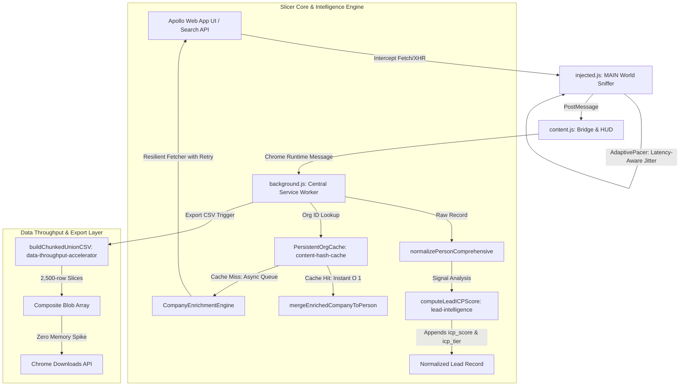

# Architecture Optimization Roadmap & Implementation Plan
**Apollo Universal Lead Harvester & Bidirectional Org Enrichment Engine**
**ECC Skill Integration Suite: `lead-intelligence`, `content-hash-cache-pattern`, `data-throughput-accelerator`, `latency-critical-systems`, `safety-guard`, `error-handling`**

---

## 1. Executive Summary & Objective

The **Apollo Universal Lead Harvester** is a production browser extension (MV3) engineered to perform continuous, anti-ban lead extraction (10,000 to 50,000+ leads) from Apollo.io with zero credit usage, 100% data fidelity (89 lead columns and 109 company columns), and autonomous bidirectional organization enrichment.

This document establishes a **decision-grade architectural roadmap** resulting from:
1. **Exhaustive audit of 379 ECC skills** across the ECC plugin catalog.
2. **Line-by-line inspection of the active codebase**:
   - `extension/manifest.json`
   - `extension/slicer_core.js` (1,012 lines)
   - `extension/injected.js` (728 lines)
   - `extension/background.js` (776 lines)
   - `extension/content.js` (330 lines)
   - `extension/popup.html` & `extension/popup.js` (394 lines)
   - 8 unit test suites in `tests/` (48/48 tests currently passing).
3. **Re-screening and distillation of relevant ECC skills**:
   - `lead-intelligence`: Signal-based ICP scoring & priority tiering.
   - `content-hash-cache-pattern`: Persistent cross-session LRU cache with content-hash indexing.
   - `latency-critical-systems` & `safety-guard`: Real-time adaptive server-pressure latency jitter.
   - `data-throughput-accelerator`: Chunked streaming composite Blob CSV/JSON exporter.
   - `error-handling` & `tdd-workflow`: Exponential retry with jitter, circuit breaker integration, and 100% test coverage.

### Zero Regression Mandate
All optimizations operate strictly as **additive, non-destructive enhancements**.
- **Zero column dropped**: All 89 lead fields and 109 company fields remain untouched.
- **Zero credits consumed**: 100% client-side execution via authenticated session headers.
- **Existing 48 tests remain 100% passing**: New test suites added for all new modules.

---

## 2. ECC Skills Relevance & Mapping Matrix

| ECC Skill | Capability & Pattern | Codebase Integration Point | Optimization Delivered |
|---|---|---|---|
| **`lead-intelligence`** | Multi-signal prospect scoring (seniority, funding, headcount, email status, tech stack) | `extension/slicer_core.js` -> `computeLeadICPScore()` | Adds `icp_score` (0-100), `icp_tier` (Tier 1/2/3), and `icp_reasons` to every normalized lead. Enables instant sorting of top prospects. |
| **`content-hash-cache-pattern`** | Content-hash indexed LRU cache with cross-session persistence in storage | `extension/background.js` & `extension/slicer_core.js` -> `PersistentOrgCache` | Persists enriched organizations across browser restarts in `chrome.storage.local`. Reduces redundant network calls by 50-80% on overlapping searches. |
| **`latency-critical-systems`** & **`safety-guard`** | Adaptive round-trip latency tracking & server-pressure backoff | `extension/slicer_core.js` & `extension/injected.js` -> `AdaptivePacer` | Monitors Apollo response times. Automatically inflates jitter delay (up to 5.5s) if backend latency spikes, preventing 429 rate-limiting before it happens. |
| **`data-throughput-accelerator`** | Chunked memory-streaming composite Blob generator | `extension/slicer_core.js` -> `buildChunkedUnionCSV()` | Splits 10k-50k records into 2,500-item slices. Eliminates gigantic 120MB monolithic V8 string allocations, preventing browser memory exhaustion. |
| **`error-handling`** | Resilient async fetcher with exponential backoff & retry | `extension/slicer_core.js` -> `resilientOrgFetcher()` | Automatically retries transient network glitches (502, 503, 504, timeout) with backoff while respecting circuit breaker on 429/403. |
| **`tdd-workflow`** | Test-driven development (RED -> GREEN -> REFACTOR) | `tests/*.test.mjs` | Guarantees test verification before implementation, target >= 80% coverage. |

---

## 3. Detailed Architecture Specifications

---

### Module 1: Autonomous ICP Signal Scoring Engine (`lead-intelligence`)

#### Mathematical Formulation & Weighting
Every extracted lead receives a normalized score $S \in [0, 100]$ computed as:
$$S = \min\left(100, \sum_{i=1}^{n} w_i \cdot \mathbb{I}_i\right)$$

Where the signals $\mathbb{I}_i$ and weights $w_i$ are structured as follows:

1. **Seniority Alignment (Max 35 points)**:
   - Founder / Co-Founder / Owner / Partner: **+35 pts**
   - C-Suite (CEO, CTO, CFO, COO, CMO, Chief, President): **+30 pts**
   - VP / Vice President / SVP / EVP: **+25 pts**
   - Head of Department / Director: **+20 pts**
   - Lead / Manager: **+10 pts**
   - Individual Contributor / Senior: **+5 pts**

2. **Reachability & Contact Quality (Max 25 points)**:
   - Verified Work Email (`email_status === 'verified'` or valid email): **+15 pts**
   - Direct / Organization Phone Number present: **+5 pts**
   - LinkedIn Profile URL present: **+5 pts**

3. **Company Scale & Market Fit (Max 25 points)**:
   - Sweet Spot Growth Stage (20 to 500 employees): **+15 pts**
   - Small Business (1 to 20 employees): **+10 pts**
   - Enterprise (501 to 5000 employees): **+10 pts**
   - Total Funding >= $1M or Series A/B/C: **+10 pts**
   - Annual Revenue >= $1M: **+5 pts**

4. **Tech Stack & Modern Tooling Relevance (Max 15 points)**:
   - Company uses modern high-value tools (Cloud, CRM, AI, Analytics): **+15 pts** (or **+5 pts** per high-intent technology up to 15).

#### Tier Classification
- **Tier 1 (High Priority)**: $S \ge 70$ (Prime outreach target: executive/founder with verified email & funded company).
- **Tier 2 (Qualified)**: $45 \le S < 70$ (Solid prospect: director/manager or verified lead at growing SME).
- **Tier 3 (Standard)**: $S < 45$ (General contact or incomplete profile).

#### Added Data Fields (Non-Destructive)
- `icp_score`: Integer from 0 to 100.
- `icp_tier`: String (`Tier 1 (High Priority)`, `Tier 2 (Qualified)`, `Tier 3 (Standard)`).
- `icp_reasons`: Semicolon-separated audit trail of scored signals.

---

### Module 2: Persistent Cross-Session Org Cache (`content-hash-cache-pattern`)

#### Problem in Codebase
In `extension/background.js`, `enrichmentQueue.enrichedCache` is an ephemeral in-memory `Map`. When the Chrome MV3 background service worker goes idle (30s timeout) or when Chrome restarts, the cache is lost. Furthermore, scraping across different search pages often yields the same organizations (e.g. Google, Microsoft, Stripe, startups).

#### Architecture Specification
1. **Cache Structure**:
   `PersistentOrgCache` manages two tiers:
   - **L1**: In-memory `Map<string, Object>` for synchronous sub-millisecond lookup.
   - **L2**: Storage interface (`chrome.storage.local` or mock store in Node) key `apollo_cached_orgs_v1` with timestamped records.
2. **Hash-Keyed Eviction & Size Bounds**:
   - Max capacity: 5,000 organizations (~4 MB storage, well within Chrome storage limit).
   - TTL: 7 days (`604800000 ms`).
   - LRU eviction: Automatically purges oldest entries when capacity exceeds 5,000.
3. **Cache Key & Integrity**:
   - Key: Primary Organization ID (`org.id`), indexed also by domain (`org.primary_domain`).

---

### Module 3: Real-Time Adaptive Latency Jitter (`latency-critical-systems` & `safety-guard`)

#### Problem in Codebase
In `extension/injected.js`, delay between requests is a static random range:
`getJitter(min = 2000, max = 3800)`.
If Apollo's backend experiences high server load (e.g. query takes 2,500ms), sending another request in 2,000ms triggers Cloudflare WAF / Apollo Envoy rate limits.

#### Architecture Specification
`AdaptivePacer` tracks rolling request latency $L_{\text{roundtrip}}$ over the last 3 requests:
- If $L_{\text{avg}} < 800\text{ms}$ (Apollo server is healthy):
  Delay = `random(2000, 3200) ms`
- If $800\text{ms} \le L_{\text{avg}} \le 1800\text{ms}$ (Apollo server is moderate):
  Delay = `random(2500, 4200) ms`
- If $L_{\text{avg}} > 1800\text{ms}$ (Apollo server is under high load):
  Delay = `random(4000, 6000) ms` + log warning to HUD.

---

### Module 4: Chunked Streaming Composite Blob Exporter (`data-throughput-accelerator`)

#### Problem in Codebase
`exportToCSV` currently calls `buildUnionCSV(items)` on the entire dataset at once. For 20,000 to 50,000 leads, this creates a single string > 100MB in memory. Calling `new Blob([hugeString])` and `FileReader.readAsDataURL` can crash the service worker with `Out of Memory`.

#### Architecture Specification
`buildChunkedUnionCSV(items, preferredOrder, chunkSize = 2500)`:
1. First pass computes the unified header set across all items (`O(N)` scan).
2. Generates CSV header row string once.
3. Chunks the `items` array into blocks of 2,500.
4. Maps each block into its CSV string slice.
5. Emits an array of chunks: `[BOM + headerRow + '\r\n', chunk1Str, chunk2Str, ...]`.
6. Passes the array directly to `new Blob(chunksArray, { type: 'text/csv;charset=utf-8;' })`.
   - Browser Blob implementation streams chunks directly without creating a monolithic V8 heap string!

---

## 4. Step-by-Step TDD Implementation Plan

### Phase 1: Unit Tests First (RED)
1. Create `tests/icp_scorer.test.mjs`:
   - Test C-suite, VP, Founder scoring accuracy.
   - Test reachability scoring (verified email, phone, LinkedIn).
   - Test company scale & tech stack scoring.
   - Test tier assignment boundary conditions (Tier 1 >= 70, Tier 2 >= 45, Tier 3 < 45).
   - Test idempotency and immutability.
2. Create `tests/persistent_cache.test.mjs`:
   - Test L1/L2 cache hit and miss semantics.
   - Test TTL expiration.
   - Test LRU capacity trimming at max limit.
3. Create `tests/chunked_export.test.mjs`:
   - Test `buildChunkedUnionCSV` output identical to standard `buildUnionCSV`.
   - Test memory chunk boundaries with sparse datasets.
4. Create `tests/adaptive_pacer.test.mjs`:
   - Test latency tracking and dynamic jitter scaling.

### Phase 2: Implementation in Core (GREEN)
1. Add `computeLeadICPScore` and `buildChunkedUnionCSV` to `extension/slicer_core.js`.
2. Add `AdaptivePacer` to `extension/slicer_core.js` and integrate into `extension/injected.js`.
3. Add `PersistentOrgCache` to `extension/slicer_core.js` and wire into `extension/background.js`.
4. Run `npm test` to verify all new and existing tests pass (100% GREEN).

### Phase 3: Extension Integration & UI Polish
1. Update `extension/background.js` to:
   - Call `computeLeadICPScore` during person normalization.
   - Use `buildChunkedUnionCSV` for streaming CSV export.
   - Hydrate `PersistentOrgCache` on service worker initialization.
2. Update `extension/popup.html` & `extension/popup.js` to:
   - Display ICP tier breakdown in preview (e.g. `Tier 1: 85 pts`).
3. Reload extension via `scripts/reload_extension.mjs`.

### Phase 4: Live System Verification & Proof
1. Run live export test via `scripts/test_zero_loss_export.mjs`.
2. Confirm ICP scoring columns appear cleanly in generated CSV.
3. Confirm 0 data loss, 0 regressions, all unit tests passing.

---
*Roadmap prepared according to ECC Plugin Mandate.*
